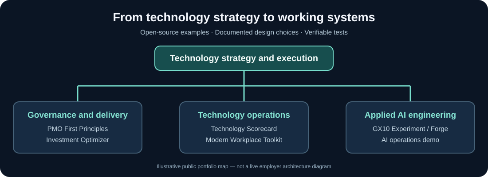

# Dietrich Eubank

### Technology Leadership · Enterprise IT · Applied AI

**Connecting technology strategy, organizational capability, and hands-on engineering.**

---

I lead and build technology services with an emphasis on **reliability, measurable outcomes, useful governance, and developing people**. This account brings together public engineering experiments and original tools informed by my work across modern workplace technology, IT delivery, and AI infrastructure.

[Explore the portfolio map and architecture narrative](docs/portfolio-map.md). Diagram is illustrative, not a live infrastructure export.

## Featured interactive experience

### [Technology Leadership Lab](https://dietricheubank.github.io/lab/)

Connect enterprise strategy, portfolio decisions, modern workplace architecture, delivery and service measurement through a fictional, interactive technology organization scenario.

[Launch the lab](https://dietricheubank.github.io/lab/) · [Clinical endpoint modernization simulation](https://dietricheubank.github.io/lab/clinical-endpoints/) · [Operating model diagram](https://dietricheubank.github.io/assets/operating-model.svg) · [Modern workplace reference architecture](https://dietricheubank.github.io/assets/modern-workplace-reference.svg)

### [Clinical Modernization Executive Dashboard](https://dietricheubank.github.io/lab/clinical-dashboard/)

Explore fictional clinical endpoint rollout indicators, readiness gates, deployment capacity and operational health. This is a planning demonstration—not a real clinical program report.

### [Unified Communications Migration Simulator](https://dietricheubank.github.io/lab/uc-migration/)

Model a fictional Teams Phone migration using user waves, telephone-number readiness, licensing, call testing, emergency-calling checks and support acceptance.

## Featured projects

| Project | What it demonstrates | Explore |
|:---|:---|:---|
| **PMO First Principles** | Ten-lesson practical project management course, knowledge checks, worksheets, and an eight-domain self-assessment | [Course](https://dietricheubank.github.io/pmo-first-principles/) · [Workflow](https://github.com/dietricheubank/pmo-first-principles/blob/main/docs/first-principles-workflow.md) · [Source](https://github.com/dietricheubank/pmo-first-principles) |
| **Technology Scorecard** | Direction-aware KPI measures and documented, synthetic executive reporting examples | [Demo](https://dietricheubank.github.io/demos/technology-scorecard/) · [Repository](https://github.com/dietricheubank/Technology-Scorecard) |
| **IT Investment Optimizer** | Exact small-portfolio selection within budgets and dependencies, with testable Python logic | [Demo](https://dietricheubank.github.io/demos/investment-optimizer/) · [Repository](https://github.com/dietricheubank/it-investment-optimizer) |
| **Modern Workplace Toolkit** | Endpoint lifecycle evidence checks from request through secure retirement | [Repository](https://github.com/dietricheubank/modern-workplace-toolkit) |
| **GX10 Experiment** | Multi-node local AI inference, architecture, and operational lessons | [Case study](https://github.com/dietricheubank/GX10Experment) |
| **Project Priority Studio 2.0** | Browser-based weighted scoring, effort/benefit visualization, dependency-aware shortlist, CSV export | [Try it](https://dietricheubank.github.io/tools/priority-scoring/v2.html) |

## Working demonstrations

- **[AI Operations Approval Demo](https://dietricheubank.github.io/demos/ai-ops/)** — a **synthetic** incident, explicit human approval, and simulated remediation; no live operational connection.
- **[Forge Engineering Case Study](https://dietricheubank.github.io/case-studies/forge.html)** — architectural decisions and reliability lessons from local AI exploration.
- **[IT Leadership Playbook](https://dietricheubank.github.io/leadership/)** — editable templates for PMO work, operational scorecards, RACI, architecture decisions, and 90-day planning.
- **[Technology Insights](https://dietricheubank.github.io/insights/)** — short field notes about governance, observability and operating reviews.

## Areas of practice

**Enterprise technology:** Modern workplace services · Endpoint management · Collaboration platforms · IT service management · Technology governance · Project and portfolio management

**Engineering and applied AI:** Python · Linux · Docker · NVIDIA GB10 · Local LLM inference · Prometheus · Grafana · Automation patterns

**Leadership and delivery:** Operating models · Practical frameworks · Program enablement · Cross-functional execution · Measurable service outcomes

## Design principles

> Start with the outcome. Make decisions explainable. Build for operations. Develop people. Keep humans accountable for consequential actions.

The software here is intentionally scoped and documented. Public examples use fictional information, and tests demonstrate the stated behavior—not production readiness.

## Connect

**[Portfolio website](https://dietricheubank.github.io/)** · **[Public repositories](https://github.com/dietricheubank?tab=repositories)**

Personal projects and perspectives. No employer endorsement or private organizational information is implied. Some educational tools are working starters, not certified training or enterprise-approved applications.
