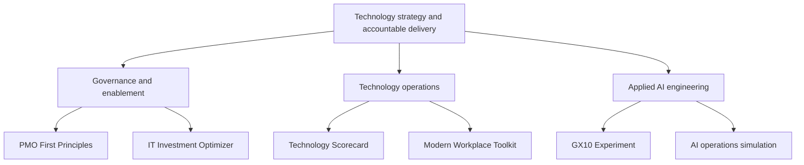

# Portfolio architecture and project map

This map is a narrative guide, not a production infrastructure diagram.

## How the public projects relate

- **PMO First Principles** develops consistent planning, delivery, and governance habits.
- **IT Investment Optimizer** models transparent allocation decisions under constraints.
- **Technology Scorecard** reports illustrative reliability and delivery measures.
- **Modern Workplace Toolkit** demonstrates evidence-based lifecycle checks.
- **GX10 Experiment** documents local AI engineering design and operational lessons.
- **AI operations demo** illustrates human approval and simulation-only changes.

All diagrams and sample data are illustrative and independent of any employer.
